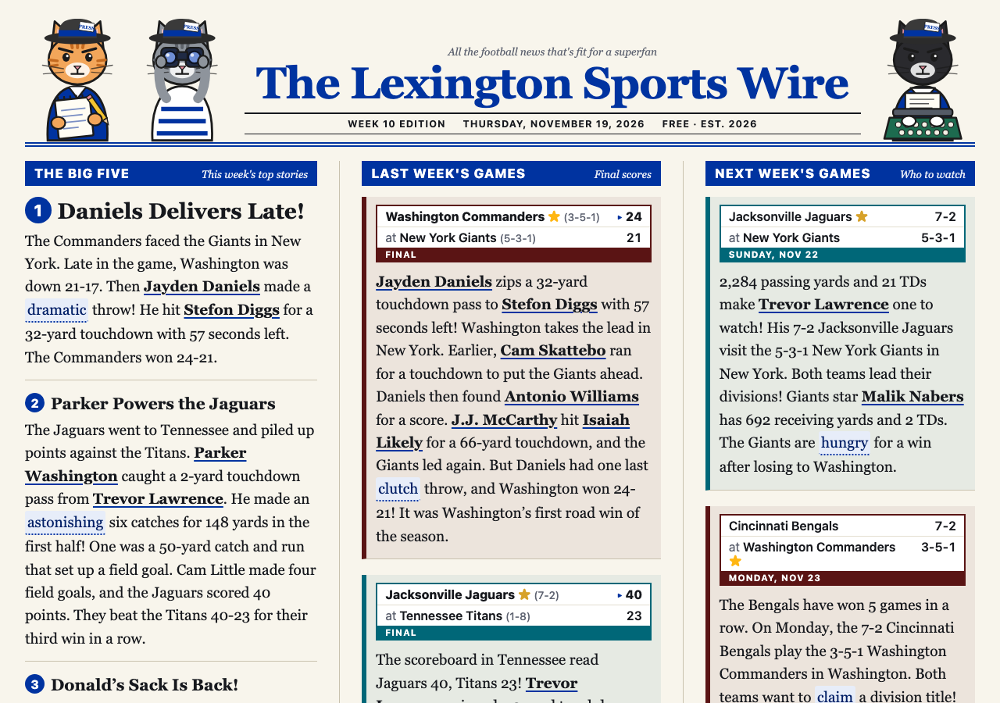

# The Lexington Sports Wire

**A weekly NFL newspaper for my 6-year-old nephew:** big, bright, written at a first-grade reading level, and
built so a kid can read about football without gambling ads, outbound links or grown-up news.

**Live site:** https://averyfullerton.github.io/lexington-sports-wire/ ·
**Search evals:** [Boring Data for Adults](https://averyfullerton.github.io/lexington-sports-wire/evals.html)



## Why I built it

My nephew loves football and is just learning to read. Most sports sites aren't made for him: they're full of
betting lines, autoplay video, ads, links that lead anywhere, and stories about arrests and injuries. So I built
him his own paper.

- **Every game, told for a first grader.** Last week's final scores with a short, lively recap, and next week's
  matchups with players to watch. Short sentences, real football words (red zone, pick-six), no invented facts.
- **New words to learn.** Each story has 1–3 "big words." He taps one and a card opens with a kid-friendly
  definition and an everyday example ("Jamal made remarkable progress at his swimming lesson.").
- **5 Big Stories** each week, picked for kids: comebacks, streaks, a star back from injury.
- **Player cards.** Tap any name for the player's team, number, position, three fun facts and a stats table.
- **His teams first.** Jaguars and Commanders games are pinned to the top in team colors.
- **A walled garden.** Five approved sources (NFL.com, ESPN, Pro Football Reference, Jaguars.com,
  Commanders.com). No outbound links, no ads, no comments, no video, no gambling content. Everything is
  checked for kid safety before it's published, and anything doubtful is dropped.
- **Made to look like a newspaper:** three columns in Kentucky blue, with original cat-reporter illustrations
  (not affiliated with the University of Kentucky).

A new edition publishes itself every Tuesday morning, after Monday Night Football.

## What it was also about: learning Parallel's APIs

The other goal was hands-on experience with [Parallel Web Systems](https://parallel.ai)' web APIs through the
`parallel-web` Python SDK, in a product with real constraints: strict sources, facts that must be right, and
content a 6-year-old reads. Each API does the job it's best at:

| Parallel API | What it does here |
|---|---|
| **Task API** (`task_run`, `base` processor, JSON output schema) | Researches each game into a structured fact sheet: score, records, top performers, key plays with game clock, storyline. Does the same for next week's previews and for each player's fun facts. Every field comes back with citations and a confidence level (`basis`); low-confidence fields are dropped before writing. |
| **Search API** (`fast` mode) | Finds the week's news for the 5 Big Stories, restricted to the 5 approved sites (`source_policy.include_domains`) and to the past week (`after_date`). |
| **Extract API** | Pulls the full text of each candidate article so stories are written from the source, not from snippets. |
| **Decisions API** | The kid-safety filter. Classifies every story twice, first the source article by topic, then the finished kid text: arrests, lawsuits, suspensions, new or serious injuries, death, gambling, abuse, other mature content. Anything short of a confident "safe" is dropped. |
| **Search + Extract as agent tools** | The [Search Evals](https://averyfullerton.github.io/lexington-sports-wire/evals.html) page: Parallel's open-source [eval harness](https://github.com/parallel-web/parallel-search-evals) on my own NFL questions, comparing Parallel Turbo, Fast and Advanced with OpenAI's built-in web search and no search at all. |

OpenAI (gpt-6.1-terra) does the writing. It only sees the verified facts the pipeline gathered, and its output
is checked for reading level, length, big-word rules and a keyword tripwire before publishing.

### What I learned

The full log, with numbers, is in [`DE_NOTES.md`](DE_NOTES.md). Highlights:

- **Task API `base` matched `core` on everything the reader sees, at about 40% of the cost.** A full week of
  14 games runs in about 5 minutes for about $0.14. Final scores and records: 28 of 28 correct.
- **Confidence isn't correctness.** In a base-vs-core test, every "medium" field was right, and the one error
  was rated "high." So the pipeline drops only "low" fields and checks player names against ESPN box scores.
- **An allowed source can still be wrong.** An ESPN column put a 66-yard touchdown at 74 yards. Stories about
  games are now fact-checked against ESPN's official scoring plays.
- **The Decisions API researches the web on its own.** A clean recap scored 0.26 for "gambling" until I told
  it to judge only the text provided. It has no source policy, so its citations are logged and never shown.
- **Search evals:** with up to 20 searches per question, every tool answered all 30 hard questions correctly;
  Parallel Fast was cheapest per right answer and OpenAI was fastest. With only 5 searches, Parallel answered
  more (Advanced 18, Fast 16, OpenAI 13 of 20), because each Parallel search hands the model about 10 results
  with page excerpts.

## How it works

```
Tuesday 7am (GitHub Actions)
  ESPN scoreboard ──► which week just finished, who plays next
  Task API ─────────► fact sheet per game (+ citations, confidence) ─► ESPN box-score name check
  OpenAI ───────────► recaps and previews from the fact sheets only ─► reading-level + tripwire checks
  Search + Extract ─► the week's news from 5 approved sites
  Decisions ────────► kid-safety check on each article, then on each finished story
  ESPN + Task API ──► player cards (official stats, fun facts)
  Static site ──────► GitHub Pages
```

- **Python 3.12** with [uv](https://docs.astral.sh/uv/), **FastAPI + Jinja2** for server-rendered pages, plain
  CSS, no JavaScript. Tap-to-open word cards use the HTML `popover` attribute.
- **GitHub Actions** runs the weekly refresh, saves the generated data to a `data` branch (so player research and
  past fact sheets are reused, not paid for again) and publishes the static site to GitHub Pages.
- A full fresh week costs a little over $1 in API calls; later weeks reuse cached player research.

## Run it locally

```sh
uv sync
cp .env.example .env          # add PARALLEL_API_KEY and OPENAI_API_KEY
uv run python -m pipeline.refresh            # research and write the latest week (or --week N)
uv run uvicorn app.main:app --reload         # http://localhost:8000
uv run python -m app.freeze --out _site      # static build, as published
```

## Repository map

| Path | What's there |
|---|---|
| `pipeline/` | The weekly pipeline: `refresh.py` (entry point), `games.py` (Task API), `write.py` (OpenAI writer), `stories.py` (Search, Extract, ranking), `safety.py` (Decisions API, tripwire), `players.py`, `verify.py` (ESPN checks) |
| `app/` | The FastAPI reader, templates, styles and the static-site builder |
| `config/domains.json` | The source allowlist and blocklist, the single source of truth |
| `evals/` | Eval question sets, judge prompt and results ([details](evals/README.md)) |
| `DE_NOTES.md` | Findings log: latency, cost, accuracy, surprises |
| `.github/workflows/weekly.yml` | The Tuesday refresh and publish |
